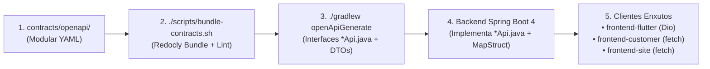

# Arquitetura e Diretrizes: API-First e Contratos de API no ispERP
**Documento Oficial de Engenharia & Governança**  
**Data de Atualização:** 2026-10-14  
**Status:** Oficial / Consolidado  
**Regra Vinculada:** [`.agents/rules/api-first-contracts.md`](file:///Volumes/240/Code/ispERP/.agents/rules/api-first-contracts.md)  
**Especificação Mestre:** [`docs/SDD.md`](file:///Volumes/240/Code/ispERP/docs/SDD.md)

---

## 1. Visão Geral e Princípios Fundamentais

O **ispERP** adota oficialmente a estratégia **API-First (Design-First)** como padrão arquitetural para toda comunicação entre o Backend (`backend/`), o ERP Operacional (`frontend-flutter/`), a Central do Assinante (`frontend-customer/`), o Site Institucional (`frontend-site/`) e integrações externas.

Nesse modelo, a interface de comunicação não é tratada como um subproduto do código do backend, mas sim como um **ativo de engenharia de primeira classe**, versionado e estritamente tipado antes de qualquer linha de implementação.

### Objetivos Estratégicos
1. **Suporte Nativo a Múltiplos Clientes:** O mesmo contrato alimenta o ERP Multiplataforma em Flutter (`frontend-flutter/`), a Central do Assinante (`frontend-customer/`), o Site Institucional (`frontend-site/`) e integrações de terceiros (Webhooks bancários, OLTs e BNGs).
2. **Evolução Fluida para Microsserviços:** Domínios de negócio com alta carga ou requisitos regulatórios específicos (Faturamento/Billing, Autenticação RADIUS, Triagem de O.S., Fiscal/NFCom) podem ser desacoplados preservando 100% de compatibilidade com os clientes.
3. **Eliminação de Drift e Vazamento de Entidades:** Nenhum controller no Backend expõe ou recebe entidades JPA (`@Entity`) diretamente; todos os 53 controllers implementam as interfaces geradas a partir de `contracts/openapi/`.

---

## 2. Diretriz de Segurança e Isolamento de DTOs (Zero Trust DTOs)

1. **Prevenção contra *Mass Assignment* (CWE-915):**
   - NUNCA uma entidade JPA (`@Entity`) é exposta ou recebida diretamente nos endpoints.
   - O gerador de código força os controllers a receberem e retornarem exclusivamente os DTOs declarados no contrato, garantindo que campos internos (`password_hash`, segredos de API, chaves privadas) nunca sejam manipulados ou expostos indevidamente.
2. **Validação Estrita Centralizada:**
   - Regras de validação (formatos RFC de UUIDv7, CPF/CNPJ, tamanho de strings, valores monetários positivos) são declaradas no YAML do contrato e aplicadas automaticamente via Bean Validation (`@Valid`, `@NotNull`, `@Pattern`) no Java.
3. **Padronização RFC 7807 (Problem Details):**
   - Respostas de erro nunca expõem nomes de tabelas, stacktraces do Spring ou detalhes de infraestrutura do PostgreSQL.

---

## 3. Topologia Modular dos Contratos (`contracts/openapi/`)

Para manter alta legibilidade e evitar conflitos em branches do Git, a especificação é modularizada em **22 domínios** com `$ref`:

```text
ispERP/
├── contracts/
│   └── openapi/
│       ├── openapi.yaml                 # Ponto de entrada central (Info, Servers, Security, Tags, Paths)
│       ├── openapi.bundled.json         # Artefato empacotado e validado pelo Redocly CLI
│       ├── components/
│       │   ├── security.yaml            # Esquema JWT Bearer (RFC 7519)
│       │   ├── errors.yaml              # Padronização RFC 7807 (Problem Details)
│       │   └── common.yaml              # Tipos utilitários (UUIDv7, Paginação)
│       └── domains/
│           ├── audit/                   # Logs de Auditoria Administrativa
│           ├── auth/                    # Login e Tokens JWT
│           ├── backup/                  # Backup & Disaster Recovery (AES-256-GCM / ZSTD)
│           ├── bi/                      # Indicadores Executivos (MRR, ARPU, Churn)
│           ├── billing/                 # Faturas, Pix, Régua de Cobrança e Rebalanceamento
│           ├── companies/               # Empresas e Filiais do Provedor
│           ├── contracts/               # Contratos, Templates e Assinatura Eletrônica via Pix
│           ├── customers/               # Cadastro e Busca de Assinantes
│           ├── financial/               # Plano de Contas, Contas a Pagar, Custódia de Caixa, DRE, Desalavancagem
│           ├── fiscal/                  # NFCom Modelo 62, Certificado A1, Convênio 115 e Regimes
│           ├── ftth/                    # Topologia Óptica, Monitoramento NOC e Despacho Técnico
│           ├── geocoding/               # GeoCEP e Otimização de Rotas
│           ├── helpdesk/                # Chamados de Suporte e Protocolo ANATEL
│           ├── infra/                   # Setup Inicial, Gateways de Pagamento, Notificações e Storage S3
│           ├── inventory/               # Almoxarifados, Estoque, Ativos Serializados e Cautela de Ferramentas
│           ├── network/                 # OLTs, ONUs, IPAM, CGNAT e Marco Civil da Internet
│           ├── plans/                   # Catálogo de Planos Comerciais
│           ├── portal/                  # Central do Assinante (Autenticação CPF+PIN, 2ª Via, Desbloqueio 48h)
│           ├── radius/                  # Servidores NAS/BNG, Sessões PPPoE e Políticas de Ciclo de Vida
│           ├── sales/                   # Vendas e Onboarding
│           ├── settings/                # Configurações Visuais e Institucionais
│           ├── users/                   # Colaboradores e Controle de Acesso (RBAC)
│           └── workorders/              # Ordens de Serviço e Execução Técnica de Campo
```

---

## 4. Pipeline de Automação e Consumo nas 4 Stacks



* **Bundler & Linter (`./scripts/bundle-contracts.sh`):** Resolve todas as árvores de `$ref`, valida a especificação OpenAPI 3.0.3 e gera `contracts/openapi/openapi.bundled.json` (sincronizando com `docs/portal/openapi.bundled.json`).
* **Gerador Backend (`./scripts/generate-api.sh`):**
  - Configurado no Gradle com `interfaceOnly = true`. Gera as interfaces Spring MVC (`br.dev.xb.isperp.api.contract.*Api`) e os DTOs Java 25 (`br.dev.xb.isperp.api.dto.*`).
  - Os 53 Controllers Java implementam essas interfaces com `@Override`. Se o contrato mudar, o compilador Java aponta imediatamente o ponto de ajuste.
* **Clientes nos Frontends (`frontend-flutter`, `frontend-customer`, `frontend-site`):**
  - Utilizam repositórios HTTP enxutos (`Dio` no Flutter; `fetch` nativo em Vanilla TypeScript nos portais web) e modelos de domínio próprios, validados contra os schemas do contrato OpenAPI.
* **Portal de Documentação Interativa:**
  - `./scripts/view-docs.sh`: Servidor local com live-reload.
  - `./scripts/view-docs.sh --portal`: Compila e abre o portal completo com Redocly.

---

## 5. Fluxo de Trabalho Diário (Step-by-Step)

Sempre que uma nova funcionalidade, campo ou rota for necessária:

1. **Passo 1 (Contrato Primeiro):** Declarar o endpoint e os schemas no arquivo YAML do domínio correspondente em `contracts/openapi/domains/<dominio>/` e referenciá-los em `contracts/openapi/openapi.yaml`.
2. **Passo 2 (Codegen Backend):** Executar `./scripts/generate-api.sh`.
3. **Passo 3 (Implementação no Backend):** Implementar o método `@Override` da interface `*Api` no Controller Spring Boot, utilizando MapStruct para converter entre Entidades e DTOs, e criar o teste automatizado correspondente.
4. **Passo 4 (Consumo no Frontend):** Consumir a rota homologada no repositório do `frontend-flutter`, `frontend-customer` ou `frontend-site` e validar com testes unitários.

---

## 6. Contratos da Central do Assinante e Gestão de PIN (`/api/portal/client` e `/customers/{id}/reset-pin`)

O ecossistema desacoplado da Central do Assinante (`frontend-customer`) consome endpoints dedicados protegidos por validação de CPF/CNPJ, PIN de 4 dígitos com bloqueio contra força bruta (lockout após 5 tentativas inválidas) e ocultação preventiva de `customerId` antes da comprovação do PIN.

### 6.1. Autenticação do Assinante (`POST /api/portal/client/auth`)
- **Rota:** `POST /api/portal/client/auth`
- **Corpo da Requisição (JSON):**
  ```json
  {
    "document": "200.370.410-88",
    "pin": "1234"
  }
  ```
- **Respostas Possíveis:**
  - `200 OK` com `status: "AUTHENTICATED"`: Acesso liberado. Retorna `customerId`, `customerName`, `maskedDocument`, `hasPin: true` e objeto `customer`.
  - `200 OK` com `status: "PIN_REQUIRED"`: Cliente possui PIN cadastrado; retorna `customerId: null` (prevenção de IDOR pré-autenticação) e solicita o PIN de 4 dígitos.
  - `200 OK` com `status: "FORCE_CHANGE_PIN"`: O PIN foi resetado pelo suporte ou é o primeiro acesso; exige definição de novo PIN.

### 6.2. Dashboard do Assinante (`GET /api/portal/client/dashboard`)
- **Rota:** `GET /api/portal/client/dashboard`
- **Identificação:** Via cabeçalho `X-Customer-Id: <UUID>` ou parâmetro `?customerId=<UUID>`.
- **Retorno:** Dados do assinante, contrato ativo, plano contratado, faturas pendentes/vencidas/pagas e elegibilidade para Desbloqueio em Confiança.

### 6.3. Desbloqueio em Confiança de 48 Horas (`POST /api/portal/client/trust-unblock`)
- **Rota:** `POST /api/portal/client/trust-unblock`
- **Comportamento:** Reativa temporariamente (48h) a conexão suspensa uma vez por ciclo de faturamento e publica o evento de desbloqueio imediato para o servidor RADIUS / BNG.

### 6.4. Cadastro e Alteração de PIN pelo Cliente (`POST /api/portal/client/pin`)
- **Rota:** `POST /api/portal/client/pin`
- **Segurança:** Caso o cliente já possua PIN ativo (`hasPin = true` e `pinForceChange = false`), o envio do `currentPin` correto é obrigatório.

### 6.5. Reset Administrativo de PIN pelo Operador (`POST /customers/{id}/reset-pin`)
- **Rota:** `POST /customers/{id}/reset-pin`
- **Acesso:** Autenticado via JWT (`ADMIN`, `ATTENDANT`, `FINANCIAL`). Registra evento na trilha de auditoria (`AuditLogService`).
