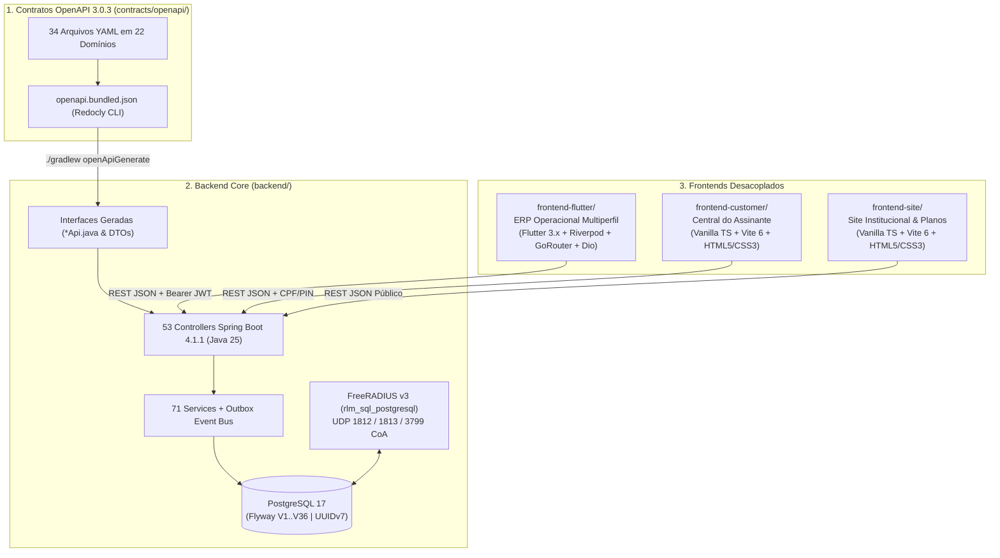

# SDD — System Design & Specification Document (`ispERP`)

**Versão:** 2.0 (Realinhamento Arquitetural & Spec-Driven Development)  
**Data de Atualização:** 14 de Outubro de 2026  
**Status:** Especificação Oficial Ativa (Fonte Única da Verdade de Engenharia)

---

## 1. Propósito e Escopo do SDD

Este **System Design & Specification Document (SDD)** consolida a arquitetura real, os contratos de comunicação, o modelo de dados, o estado de implementação de cada componente e o plano estruturado de evolução do **ispERP**.

Qualquer nova funcionalidade, refatoração ou correção deve respeitar estritamente:
1. **Workflow API-First (`contracts/openapi/`):** Toda rota HTTP e DTO nasce no contrato OpenAPI 3.0.3 antes de ser implementada no Backend ou consumida nos Frontends.
2. **Zero Dados Falsos e Desenvolvimento Sob Demanda:** Proibição absoluta de mocks estáticos em telas de produção ou funcionalidades não solicitadas ([`.agents/rules/zero-fake-data-demand-driven.md`](file:///Volumes/240/Code/ispERP/.agents/rules/zero-fake-data-demand-driven.md)).
3. **Sobriedade Terminológica:** Uso exclusivo de nomenclatura técnica, contábil e regulatória padrão da indústria de telecomunicações ([`.agents/rules/sobriedade-terminologica-e-zero-exageros.md`](file:///Volumes/240/Code/ispERP/.agents/rules/sobriedade-terminologica-e-zero-exageros.md)).
4. **Segurança e Testes Obrigatórios:** Identificadores UUIDv7, autenticação JWT com RBAC em nível de método (`@PreAuthorize`), proteção de segredos e cobertura de testes automatizados em todas as entregas.

---

## 2. Topologia do Monorepo (As 4 Stacks)

O repositório é organizado em uma arquitetura desacoplada de **4 camadas principais** mais a camada de infraestrutura containerizada:

### 2.1. Resumo Tecnológico e Licenciamento por Diretório

| Componente | Diretório | Stack Tecnológica Real | Licença | Papel no Ecossistema |
| :--- | :--- | :--- | :--- | :--- |
| **Contratos API** | [`contracts/openapi/`](file:///Volumes/240/Code/ispERP/contracts/openapi) | OpenAPI 3.0.3 + Redocly CLI | GNU AGPLv3 | Fonte única da verdade para rotas REST, schemas e validações |
| **Backend Core** | [`backend/`](file:///Volumes/240/Code/ispERP/backend) | Java 25, Spring Boot 4.1.1, PostgreSQL 17, Flyway (`V1`–`V36`), MapStruct 1.6.3, JSpecify | GNU AGPLv3 | Regras de negócio, faturamento, contabilidade, FTTH, RADIUS e integrações |
| **ERP Operacional** | [`frontend-flutter/`](file:///Volumes/240/Code/ispERP/frontend-flutter) | Flutter 3.x, Riverpod 2.6, GoRouter 14.8, Dio 5.8, FlutterSecureStorage | GNU AGPLv3 | Cliente único para colaboradores (Admin, Comercial, Suporte, Despacho, Técnico, Financeiro e Estoque) |
| **Central do Assinante** | [`frontend-customer/`](file:///Volumes/240/Code/ispERP/frontend-customer) | Vanilla TypeScript, Vite 6.1, HTML5/CSS3 (zero dependências de runtime) | MIT | Autoatendimento do assinante (login CPF+PIN, 2ª via Pix, Desbloqueio em Confiança 48h) |
| **Site Institucional** | [`frontend-site/`](file:///Volumes/240/Code/ispERP/frontend-site) | Vanilla TypeScript, Vite 6.1, HTML5/CSS3 (zero dependências de runtime) | MIT | Vitrine pública de planos ativos (`GET /plans/active`) e captação comercial |
| **Infra & RADIUS** | [`docker/`](file:///Volumes/240/Code/ispERP/docker) | Docker Compose, FreeRADIUS v3 (`rlm_sql_postgresql`), Nginx | GNU AGPLv3 | Orquestração de containers, autenticação PPPoE e proxy reverso |

---

## 3. Governança de Contratos OpenAPI & Codegen

### 3.1. Estrutura Modular (`contracts/openapi/`)
- **Arquivo Raiz:** [`contracts/openapi/openapi.yaml`](file:///Volumes/240/Code/ispERP/contracts/openapi/openapi.yaml)
- **Domínios (`contracts/openapi/domains/`):** `audit`, `auth`, `backup`, `bi`, `billing`, `companies`, `contracts`, `customers`, `financial`, `fiscal`, `ftth`, `geocoding`, `helpdesk`, `infra`, `inventory`, `network`, `plans`, `portal`, `radius`, `sales`, `settings`, `users`, `workorders`.
- **Regras de Contrato:**
  1. **Zero `@Entity` nas Respostas/Requisições:** Nenhum controller pode expor ou receber entidades JPA diretamente. Todos os 53 controllers implementam as interfaces geradas em `br.dev.xb.isperp.api.contract.*Api`.
  2. **Pipeline de Geração (`./scripts/generate-api.sh`):**
     - Executa `./scripts/bundle-contracts.sh` (Redocly `bundle` + `lint`) gerando `contracts/openapi/openapi.bundled.json`.
     - Executa `./gradlew openApiGenerate` no `backend/`, gerando as interfaces Spring `@Validated` e os DTOs Java em `backend/build/generated/openapi/`.
  3. **Consumo nos Frontends:**
     - `frontend-flutter/`, `frontend-customer/` e `frontend-site/` utilizam repositórios HTTP enxutos (`Dio` no Flutter; `fetch` nativo nos portais web) e modelos tipados próprios, mantendo zero acoplamento com geradores pesados (`built_value` ou Orval), porém rigorosamente aderentes aos schemas do `openapi.yaml`.

---

## 4. Arquitetura do Backend (`backend/`)

### 4.1. Padrões Estruturais
- **Context Path:** `/api` (configurado em `application.yml`).
- **Identificadores Primários:** 100% **UUIDv7** (RFC 9562) via `UuidCreatorUtils.generateUuidV7()` no Java e `DEFAULT uuidv7()` nativo no PostgreSQL 17.
- **Arquitetura Orientada a Eventos (Transactional Outbox):**
  - Eventos de domínio são gravados transacionalmente na tabela `outbox_events` (`V3`) e processados assincronamente com garantia *at-least-once* e controle de idempotência (`processed_events`, `V4`).
- **Mapeamento Objeto-Objeto:** MapStruct `1.6.3` (`backend/src/main/java/br/dev/xb/isperp/mapper/`).
- **Segurança (`SecurityConfig.java` + `@EnableMethodSecurity`):**
  - Autenticação stateless via JWT Bearer (`JJWT 0.13.0`) com verificação de usuário ativo (`active = true`).
  - Controle de acesso RBAC com 11 papéis (`UserRole`): `ADMIN`, `DIRECTOR`, `CFO`, `FINANCIAL`, `ATTENDANT`, `ADMINISTRATIVE_ASSISTANT`, `SUPPORT_N2`, `SUPPORT_ANALYST`, `TECHNICIAN`, `USER`, `CLIENT`.
  - Mascaramento obrigatório de credenciais sensíveis (`••••••••` + 4 últimos caracteres) em respostas `GET` de Gateways de Pagamento, Notificações, NAS e Dispositivos de Rede.
  - Validação HMAC-SHA256 *fail-closed* nos webhooks de pagamento e assinatura Pix.

### 4.2. Histórico Completo de Migrações Flyway (`V1` a `V36`)

| Migração | Descrição Técnica |
| :--- | :--- |
| `V1`–`V7` | Schema inicial (`companies`, `users`, `plans`, `customers`, `contracts`, `work_orders`, `invoices`), índices de performance, `outbox_events`, `processed_events`, `sales`, `network_devices`, `onu_provisionings`, `notification_logs`. |
| `V8`–`V12` | Portal do Assinante, roteirização de O.S. e BI, almoxarifado multi-depósito e custódia (`warehouses`, `serialized_assets`, `stock_transfers`, `tool_custody_agreements`, `custody_logs`), faturamento hierárquico e Helpdesk Anatel (`helpdesk_tickets`, `ticket_interactions`). |
| `V13`–`V17` | Fiscal NFCom Modelo 62 (`fiscal_companies`, `nfcom_records`), geolocalização nas O.S., base local GeoCEP (`cep_coordinates`), configurações dinâmicas de WhatsApp/SMTP (`notification_configs`) e multi-gateway de pagamento (`payment_gateway_configs`). |
| `V18`–`V23` | Storage S3/SeaweedFS (`storage_configs`), transição de regime tributário (`fiscal_regime_transitions`), assinatura eletrônica via Pix (`contract_templates`, `electronic_signature_sessions`), CGNAT e Marco Civil (`cgnat_mappings`, `marco_civil_reports`), IPAM (`ipam_asns`, `ipam_vrfs`, `ipam_subnets`, `ipam_ip_addresses`), Topologia FTTH (`ftth_pops`, `ftth_poles`, `ftth_cables`, `ftth_closures`, `ftth_splitters`, `ftth_fusions`, `ftth_ctos`, `ftth_cto_ports`). |
| `V24`–`V28` | Monitoramento PON e incidentes NOC (`olt_pon_ports`, `ftth_incidents`), triagem de materiais de instalação (`installation_material_demands`), políticas de ciclo de vida RADIUS (`radius_policy_configs`, `radius_lifecycle_logs`), retirada de comodato e cobrança jurídica (`legal_collection_records`), Backup & Disaster Recovery (`backup_policies`, `backup_destinations`, `backup_execution_logs`). |
| `V29`–`V31` | Gestão financeira avançada: Plano de Contas, Contas a Pagar, Custódia de Caixa por CPF, Taxas de O.S., Projetos de Rede FTTH, Alertas de Auditoria (`sentinel_audit_logs`), configurações visuais do site (`site_settings`) e logs de auditoria administrativa (`audit_logs`). |
| `V32` | Colunas de autenticação por PIN na Central do Assinante (`portal_pin_hash`, `portal_pin_must_change` em `customers`). |
| `V33` | Colunas de rastreabilidade quantitativa de estoque (`quantity`, `balance_after` em `custody_logs`). |
| `V34` | Coluna `vendor` (`MIKROTIK`, `HUAWEI`, `GENERIC`) na tabela `nas` para atributos RADIUS multi-vendor. |
| `V35` | Colunas `framed_route` (IPv4) e `framed_ipv6_route` (IPv6) em `onu_provisionings` para entrega de rotas estáticas B2B via RADIUS. |
| `V36` | Integração nativa com `rlm_sql_postgresql` do FreeRADIUS v3: criação das tabelas `radpostauth` e `nasreload`, e adição das colunas `framedipv6address`, `framedinterfaceid` e `class` em `radacct`. |

---

## 5. Matriz de Implementação do `frontend-flutter/` e Plano de Evolução

### 5.1. Matriz RBAC de Perfis no Flutter (`UserRole`)
Todos os 11 papéis do Backend devem ser mapeados em [`lib/core/models/user_role.dart`](file:///Volumes/240/Code/ispERP/frontend-flutter/lib/core/models/user_role.dart):
- **Diretoria & Administração (`ADMIN`, `DIRECTOR`):** Acesso integral a todas as rotas e configurações.
- **Gestão Financeira (`CFO`, `FINANCIAL`):** Acesso ao Cockpit Financeiro, Custódia de Caixa, Atendimento e BI.
- **Comercial & Atendimento (`ATTENDANT`, `ADMINISTRATIVE_ASSISTANT`):** Acesso ao Balcão Omnichannel (`AttendanceHubModal`), Vendas, Suporte N1 e Minha Custódia de Caixa.
- **Suporte Técnico & NOC (`SUPPORT_N2`, `SUPPORT_ANALYST`):** Acesso ao Helpdesk/Suporte, Torre de Despacho, Atendimento e Diagnóstico.
- **Campo & Almoxarifado (`TECHNICIAN`, `USER`):** Acesso às Ordens de Serviço de Campo, Execução Técnica, Almoxarifado/Custódia e Minha Custódia de Caixa.

### 5.2. Fases e Ondas de Desenvolvimento (Estritamente Sob Demanda)

#### Fase 1 (Concluída) — Alinhamento SDD, Contratos, Infra e Fechamento do Ciclo de Vida MVP
- **Entrega 1.1 (Documentação & Contratos OpenAPI — Concluída):**
  - Criação deste `docs/SDD.md` e atualização de `docs/` e `.agents/rules/`.
  - Migração dos 8 endpoints manuais (`UserController`, `InventoryController`, `AssetCustodyController`, `WorkOrderController`, `TechnicianFieldExecutionController`) para `contracts/openapi/`, eliminando retornos de `@Entity`.
- **Entrega 1.2 (Infraestrutura Docker & CI/CD — Concluída):**
  - Otimização de `.github/workflows/deploy-pages.yml` (`@v7`/`@v5` Node 24 + `paths-ignore` + 5 pilares de economia).
  - Conversão de `docker/Dockerfile.backend` para multi-stage build e remoção de `docker/wait-for-mysql.sh`.
  - Correção de conflito de portas e configuração Nginx (`docker/nginx-prod.conf`) em `docker-compose.prod.yml` e inclusão do serviço `customer` (`docker/Dockerfile.customer`).
- **Entrega 1.3 (Saneamento de Bugs, RBAC e Integração Real das 5 Telas do `frontend-flutter` — Concluída):**
  - Correção de `/radius/nas` em `nas_repository.dart`.
  - Mapeamento de todos os papéis RBAC do backend em `user_role.dart`.
  - Remoção de todos os dados hardcoded e integração real das 5 telas:
    1. `SalesDashboardScreen` ➔ `GET /plans/active` e `POST /sales`.
    2. `TechnicianDashboardScreen` ➔ `GET /work-orders` e `POST /technician/execution/{id}/complete`.
    3. `SupportDashboardScreen` ➔ `GET /work-orders` e busca integrada ao `AttendanceHubModal` (`GET /customers/search`).
    4. `FinancialDashboardScreen` ➔ Ação real de Desbloqueio em Confiança (`POST /radius/lifecycle/action`).
    5. `MyCashCustodyScreen` ➔ `GET /financial/custody/cash/all` e `GET /financial/custody/cash/deposit/pending`.

#### Ondas Subsequentes no `frontend-flutter` (Estritamente Sob Demanda)
- **Onda A (Concluída) — Governança, Catálogo & Minutas, Configurações Unificadas e Backup DR:**
  - **Catálogo & Minutas (`/admin/catalog`):** [`catalog_repository.dart`](file:///Volumes/240/Code/ispERP/frontend-flutter/lib/features/admin/data/catalog_repository.dart) e [`catalog_and_templates_screen.dart`](file:///Volumes/240/Code/ispERP/frontend-flutter/lib/features/admin/presentation/catalog_and_templates_screen.dart) integrando CRUD de Planos (`/plans`) e Templates de Contrato (`/contracts/templates`, `/variables`, `/clone`, `/preview`), mais atalho direto em `SalesDashboardScreen`.
  - **Configurações Unificadas (`/admin/settings`):** [`system_settings_repository.dart`](file:///Volumes/240/Code/ispERP/frontend-flutter/lib/features/admin/data/system_settings_repository.dart) e [`system_settings_screen.dart`](file:///Volumes/240/Code/ispERP/frontend-flutter/lib/features/admin/presentation/system_settings_screen.dart) reunindo 5 abas: Empresas & Filiais (`/companies`), Site Vitrine (`/site-settings`), Storage S3/Local (`/storage/config` e `/storage/config/test`), Notificações WhatsApp/SMS (`/notifications/configs`) e Gateway Xingubit Pay (`/payment-gateways`).
  - **Backup & Disaster Recovery (`/admin/backup`):** [`backup_dr_repository.dart`](file:///Volumes/240/Code/ispERP/frontend-flutter/lib/features/admin/data/backup_dr_repository.dart) e [`backup_dr_screen.dart`](file:///Volumes/240/Code/ispERP/frontend-flutter/lib/features/admin/presentation/backup_dr_screen.dart) integrando `/financial/backup/overview`, `/policies` (AES-256-GCM com exibição única da Master Key e termo de responsabilidade Zero-Knowledge), `/destinations`, `/execute`, `/history` e `/emergency-kit`.
- **Onda B (Concluída) — Engenharia de Rede, Topologia FTTH, RADIUS Sessions, IPAM, CGNAT e Marco Civil:**
  - **Engenharia & NOC FTTH em 4 Abas (`/network` — [`network_ftth_repository.dart`](file:///Volumes/240/Code/ispERP/frontend-flutter/lib/features/network/data/network_ftth_repository.dart) + [`network_engineering_screen.dart`](file:///Volumes/240/Code/ispERP/frontend-flutter/lib/features/network/presentation/network_engineering_screen.dart)):**
    1. `NOC & Monitoramento PON` ([`noc_monitoring_and_incidents_tab.dart`](file:///Volumes/240/Code/ispERP/frontend-flutter/lib/features/network/presentation/noc_monitoring_and_incidents_tab.dart)): Telemetria PON (`/ftth/monitoring/pon-ports/*`) e Gestão de Incidentes Massivos (`/ftth/monitoring/incidents/*`).
    2. `OLTs & ONUs Provisionadas` ([`olts_and_onus_tab.dart`](file:///Volumes/240/Code/ispERP/frontend-flutter/lib/features/network/presentation/olts_and_onus_tab.dart)): Inventário de OLTs/MikroTik (`/network-devices`) e Provisionamento/Sinal Óptico/Autorização de ONUs (`/onus/*`).
    3. `Topologia FTTH & CTOs` ([`ftth_topology_and_ctos_tab.dart`](file:///Volumes/240/Code/ispERP/frontend-flutter/lib/features/network/presentation/ftth_topology_and_ctos_tab.dart)): POPs, Postes, Cabos Ópticos (`/ftth/topology/map`, `/pops`, `/poles`, `/cables`), CTOs, Portas e Viabilidade Geo (`/ftth/ctos/*`).
    4. `CEOs, Splitters & Fusões` ([`closures_and_fusions_tab.dart`](file:///Volumes/240/Code/ispERP/frontend-flutter/lib/features/network/presentation/closures_and_fusions_tab.dart)): Diagramas de Bandeja, Splitters, Fusões FO (`/ftth/closures/*`, `/ftth/fusions/*`) e Rastreio Óptico Ponta-a-Ponta (`/ftth/trace/cto/{ctoId}`).
  - **Governança de Rede, RADIUS, IPAM e Marco Civil em 5 Abas (`/admin/nas` — [`radius_ipam_marcocivil_repository.dart`](file:///Volumes/240/Code/ispERP/frontend-flutter/lib/features/admin/data/radius_ipam_marcocivil_repository.dart) + [`nas_management_screen.dart`](file:///Volumes/240/Code/ispERP/frontend-flutter/lib/features/admin/presentation/nas_management_screen.dart)):**
    1. `Concentradores BNG / NAS` (`/radius/nas`, `/radius/nas/{id}/toggle`).
    2. `Sessões RADIUS & PoD` ([`radius_sessions_and_pod_tab.dart`](file:///Volumes/240/Code/ispERP/frontend-flutter/lib/features/admin/presentation/radius_sessions_and_pod_tab.dart)): Sessões PPPoE ativas (`/radius/sessions/active`), histórico por assinante e disparo de Packet of Disconnect RFC 5176 UDP 3799 (`/radius/disconnect`).
    3. `Auto-Corte & Ciclo de Vida` ([`radius_lifecycle_tab.dart`](file:///Volumes/240/Code/ispERP/frontend-flutter/lib/features/admin/presentation/radius_lifecycle_tab.dart)): Política de corte/redução Res. 632 Anatel (`/radius/lifecycle/policy`), execução da régua (`/enforce-dunning`), ação manual (`/action`) e trilha de auditoria (`/logs`).
    4. `IPAM IPv4/IPv6 & VLSM` ([`ipam_management_tab.dart`](file:///Volumes/240/Code/ispERP/frontend-flutter/lib/features/admin/presentation/ipam_management_tab.dart)): ASNs (`/ipam/asns`), VRFs (`/ipam/vrfs`), Sub-redes CIDR (`/ipam/subnets`), Calculadora CIDR, Split VLSM (`/split`) e Inventário/Alocação de IPs (`/ips/*`).
    5. `CGNAT & Marco Civil` ([`cgnat_and_marco_civil_tab.dart`](file:///Volumes/240/Code/ispERP/frontend-flutter/lib/features/admin/presentation/cgnat_and_marco_civil_tab.dart)): Mapeamentos PBA determinísticos (`/cgnat/mappings`), Investigação Forense Reversa Lei 12.965/2014 (`/marco-civil/identify`) e Emissão/Validação de Laudos Periciais com SHA-256 (`/marco-civil/reports/*`).
- **Onda C (Concluída) — Gestão Financeira Avançada, DRE e Custódia Patrimonial:**
  - **Cockpit Financeiro (`/financial` — [`financial_dashboard_screen.dart`](file:///Volumes/240/Code/ispERP/frontend-flutter/lib/features/financial/presentation/financial_dashboard_screen.dart)):**
    1. `Cobrança & Régua` (Dunning RGC Anatel e Desbloqueio em Confiança).
    2. `Contas a Pagar & Plano de Contas` ([`payables_and_accounts_repository.dart`](file:///Volumes/240/Code/ispERP/frontend-flutter/lib/features/financial/data/payables_and_accounts_repository.dart) + [`payables_and_accounts_tab.dart`](file:///Volumes/240/Code/ispERP/frontend-flutter/lib/features/financial/presentation/payables_and_accounts_tab.dart)): Parcelas Pendentes (`/financial/payables/installments/pending` e `/pay`), Notas & Despesas (`/financial/payables`) e Plano de Contas Hierárquico (`/financial/chart-of-accounts/tree` e CRUD).
    3. `DRE & Desalavancagem 36M` ([`strategic_finance_repository.dart`](file:///Volumes/240/Code/ispERP/frontend-flutter/lib/features/financial/data/strategic_finance_repository.dart) + [`dre_and_deleveraging_tab.dart`](file:///Volumes/240/Code/ispERP/frontend-flutter/lib/features/financial/presentation/dre_and_deleveraging_tab.dart)): Apuração do DRE Telecom por Competência (`ACCRUAL`) e Caixa (`CASH`) (`/financial/reports/dre`), Curva de 36 Meses com os 3 Números Sagrados (`/financial/deleveraging/projection`) e Simulador de CAPEX (`/financial/deleveraging/simulate`).
    4. `Payback FTTH & Sentinela` ([`payback_and_sentinel_tab.dart`](file:///Volumes/240/Code/ispERP/frontend-flutter/lib/features/financial/presentation/payback_and_sentinel_tab.dart)): ROI por CTO/Projeto FTTH (`/financial/network-projects/payback`, criação e `/assign-cto`) e Auditoria Pericial Sentinela (`/financial/sentinel/alerts`, `/sweep` e `/resolve`).
    5. `Auditoria de Caixa & Alçadas` ([`cfo_audit_and_waivers_tab.dart`](file:///Volumes/240/Code/ispERP/frontend-flutter/lib/features/financial/presentation/cfo_audit_and_waivers_tab.dart)): Conferência de Depósitos na Boca do Caixa pelo CFO (`/financial/custody/cash/deposit/{id}/audit`) e Alçadas de Isenção de Taxa de O.S. (`/financial/work-orders/waiver/*` e `/assign-fee`).
  - **Custódia Física Dual-Acceptance (`/my-cash-custody` — [`cash_custody_repository.dart`](file:///Volumes/240/Code/ispERP/frontend-flutter/lib/features/financial/data/cash_custody_repository.dart) + [`my_cash_custody_screen.dart`](file:///Volumes/240/Code/ispERP/frontend-flutter/lib/features/financial/presentation/my_cash_custody_screen.dart)):** Liquidação de fatura em espécie (`/settle`), Solicitação de Repasse (`/transfer/request`), Bandeja de Aceite/Recusa (`/transfer/pending` + `/respond`) e Submissão de Depósito Bancário (`/deposit`).
- **Onda D (Concluída) — Módulo Fiscal & Conformidade Tributária:**
  - **6ª Aba do Cockpit Financeiro (`Fiscal & NFCom Mod. 62` em `/financial` — [`fiscal_repository.dart`](file:///Volumes/240/Code/ispERP/frontend-flutter/lib/features/financial/data/fiscal_repository.dart) + [`fiscal_and_nfcom_tab.dart`](file:///Volumes/240/Code/ispERP/frontend-flutter/lib/features/financial/presentation/fiscal_and_nfcom_tab.dart)):**
    - Empresa Fiscal Ativa (`/fiscal/company`), Upload e Validação de Certificado Digital A1 `.pfx/.p12` (`/fiscal/company/{companyId}/certificate`) e Gateway Emissor (`/fiscal/configs`).
    - Painel NFCom Modelo 62 (`/fiscal/records`, `/fiscal/invoices/{id}/emit`, `/fiscal/records/{recordId}/cancel`) com inspeção de XML autorizado e botão rápido de emissão no Atendimento 360 ([`step_invoice_payment.dart`](file:///Volumes/240/Code/ispERP/frontend-flutter/lib/features/attendance/presentation/steps/step_invoice_payment.dart)).
    - Exportação ZIP do Convênio ICMS 115/03 (`/fiscal/convenio115/export`) e Envio de Fechamento Fiscal Mensal à Contabilidade (`/fiscal/convenio115/send-accounting`).
    - Agendamento, processamento e histórico de Transições de Regime Tributário (`/fiscal/regimes/transitions/*`).
